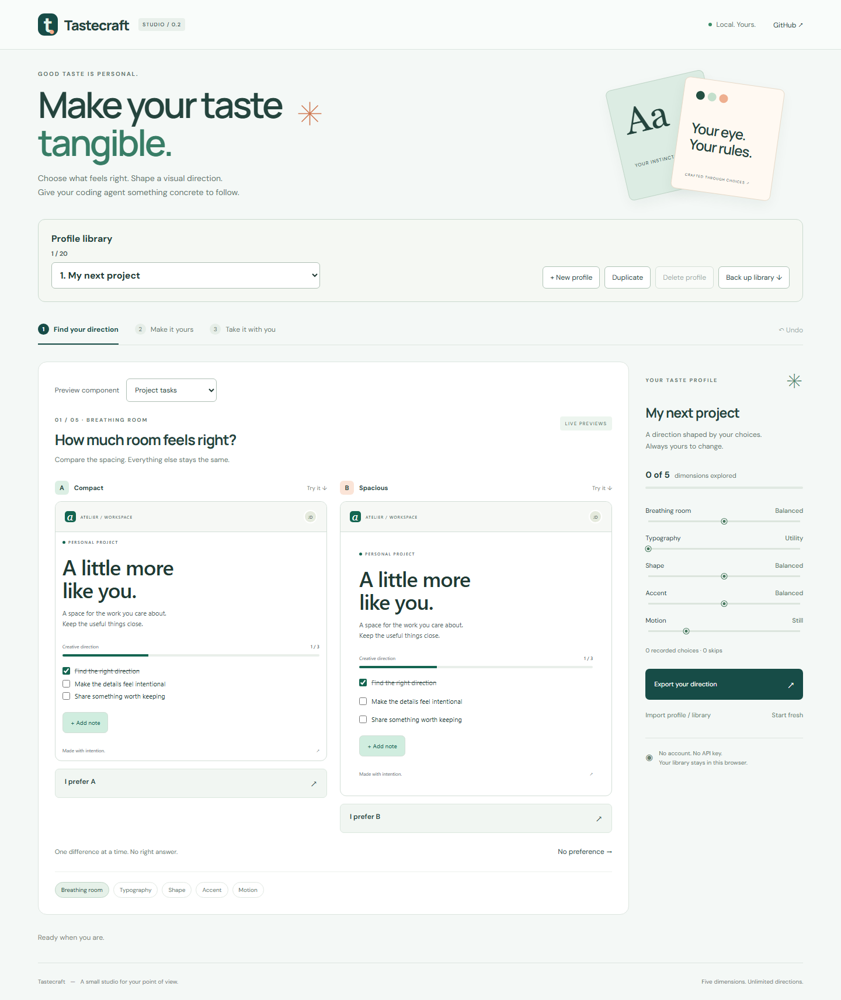

# Tastecraft

**Turn your visual choices into a design direction your coding agent can use.**

Compare functioning interfaces. Refine five dimensions. Keep a library of project directions, then export an agent skill, CSS tokens, a portable profile, and a standalone React component.

[Try the studio](https://alfonza1.github.io/tastecraft/) · [Architecture](docs/architecture.md) · [Contribute](CONTRIBUTING.md)



## Try it in a minute

Requires Node.js **22.12+** and npm. The same commands work in PowerShell, macOS, and Linux:

```text
git clone https://github.com/alfonza1/tastecraft.git
cd tastecraft
npm ci
npm run dev
```

Open **http://127.0.0.1:4322**. No API key, account, model download, or backend.

## A useful loop

1. **Find your direction.** Pick A or B in five controlled comparisons: spacing, typography, shape, accent, and motion. Each pair changes only one dimension. The checkboxes and note editor work; try them.
2. **Make it yours.** Name the project and adjust any dimension. The preview updates immediately.
3. **Take it with you.** Download the files your workflow needs:

| Output               | Use it for                                                               |
| -------------------- | ------------------------------------------------------------------------ |
| `SKILL.md`           | Project-specific guidance for a coding agent that supports skills        |
| `tastecraft.css`     | Concrete CSS custom properties, including reduced-motion overrides       |
| `tastecraft.json`    | Portable profile, values, and comparison evidence; import it to continue |
| `TastecraftCard.tsx` | A self-contained, interactive React reference with its styling included  |

For a typical agent skill directory, place the exported `SKILL.md` in `.agents/skills/project-design/`. Skill discovery paths vary by agent; follow your agent's documentation. The file is plain Markdown and can also be supplied directly as project context.

Use the CSS variables in your own components:

```css
@import "./tastecraft.css";
.project-card {
  padding: var(--tc-space);
  border-radius: var(--tc-radius);
  font-family: var(--tc-font-body);
  color: var(--tc-text);
}
.project-card h2 {
  font-family: var(--tc-font-heading);
}
```

## What works

- Five independently controlled comparisons, repeatable in any order.
- Two interactive preview components: project tasks with notes, and notification settings with a working form. Switch components while comparing the same design axis.
- Transparent preference aggregation: each non-skipped choice is 0 or 100; the retained choices on that axis are averaged. Conflicting choices move toward the middle.
- Manual refinement, up to 30 in-session undo snapshots for choices/reset, and a confirmed fresh start.
- Up to 20 named profiles: create, duplicate, switch, rename, and confirm deletion. Each retains its own values and comparison evidence.
- Whole-library JSON backups, non-destructive validated imports, and four individual profile exports.
- Safe migration from version 0.1, cross-tab conflict detection, and persistent storage-error feedback.
- Responsive layout, keyboard focus, reduced-motion support, and a native confirmation dialog.
- Bundled fonts. No analytics or outbound model calls. Hosting providers still receive ordinary page requests.

## Honest boundaries

Tastecraft **does not train an AI model**, infer a complete personality, or guarantee what another agent will generate. It captures explicit preferences and gives the agent concrete examples. The studio uses curated task and settings components; importing arbitrary React applications is not supported. The React export is a standalone task-card reference, regardless of which preview you explored.

Typography and accent are discrete choices behind their sliders; spacing, shape, and motion interpolate. Reduced-motion system settings override animation in the studio and exports. Comparison history retains the latest 100 entries. New comparisons recompute their axis from retained evidence and may replace a manual adjustment. Manual slider/name edits are saved but do not create undo snapshots.

## Keep your directions safe

The library is saved locally on this browser and origin. **Back up library** downloads every profile as `tastecraft-library.json`. **Import profile** accepts that backup or an existing version 1 `tastecraft.json`. Import adds new profiles with fresh identifiers and preserves existing work; it never replaces a matching name. A library holds 20 profiles. Individual profiles are limited to 100 KB; library imports to 1 MB. Invalid or over-capacity imports are rejected without changes.

Version 0.1 profiles migrate automatically into the library. The original `tastecraft.profile.v1` storage entry remains untouched as a fallback, but later changes live in `tastecraft.library.v2`. Corrupt data is not silently overwritten.

If another tab saves changes, this tab pauses saving and keeps its in-memory work. Back up this tab, then **Load latest library** to use the saved version; import your backup to preserve both directions. **Replace browser storage** is an explicit, confirmed overwrite option. Quota/storage failures show a persistent warning, while all editing and exports remain available. There is no automatic merging or cloud backup. Undo belongs to the active session and clears when switching profiles; deletion cannot be undone.

Persistence requires the Web Locks API on a secure origin (HTTPS or localhost). Unsupported browsers can edit and export with a visible saving warning. Export before clearing browser data or closing a tab whose saving is paused. Opening another origin creates a separate library.

## Development and validation

```text
npm run typecheck
npm run lint
npm test
npm run build
npx playwright install chromium
npm run test:e2e
```

The end-to-end suite exercises actual interactions, migration, independent profiles, two concurrent tabs, storage recovery, invalid imports, backup downloads, responsive overflow, and browser errors. It refreshes the real desktop/mobile screenshots in `docs/`. Unit tests also compile the exported React reference with TypeScript.

`npm run preview` serves the production build on port 4322. `npm run dev` uses the same fixed port and fails if occupied. Stop one before starting the other.

## Deploy your own

`npm run build` produces a static `dist/` directory with relative asset paths. Serve it on any static host. The included GitHub Pages workflow deploys the repository's default branch after checks and browser tests pass. In a fork, enable **Settings → Pages → Source: GitHub Actions**.

## Why this exists

Design instructions are more useful when they include choices and working examples. Tastecraft focuses on making those choices explicit and portable. It complements opinionated design skills and reference libraries with a small interactive workshop.

Useful future contributions: additional preview components, documented contrast-tested palettes, richer profile formats, and accessibility improvements. See [the roadmap](docs/architecture.md#next-steps).

MIT licensed. Font packages retain their respective SIL Open Font Licenses.
